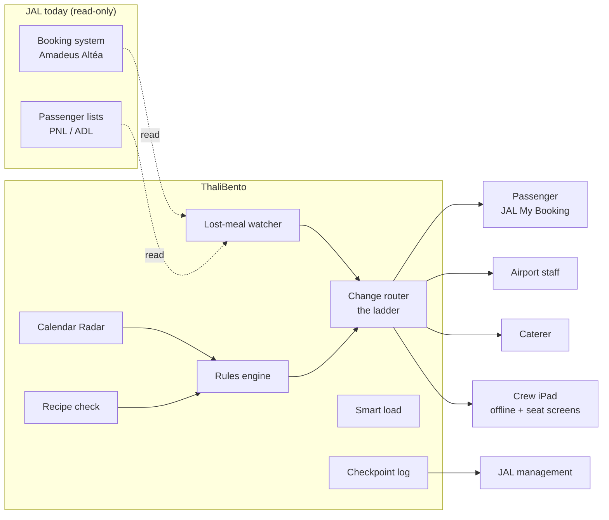

# ThaliBento 

**A special-meal safety net for Japan Airlines that plugs into the tools JAL already uses.**
थाली + 弁当: an Indian thali, packed with Japanese care.

> *"Today the airline listens once and hopes. ThaliBento keeps listening until the meal is served."*

Built during the 24-hour offline final by **Team Caffeinated Nerds** (Bhavyam Misra, Gunagye Jain, Shefali Sharma) for the **Thapar Japan Hackathon 2026**, problem statement **JAL-PS-01** by Japan Airlines.

📄 [Final pitch deck (PDF)](pitch/ThaliBento_FinalPitch.pdf) · 📄 [One-page summary](pitch/ThaliBento_OnePager.pdf) · 🎬 [Demo walkthrough video](docs/video/ThaliBento-demo-walkthrough.mp4) · 🧭 [Demo script](docs/demo-script.md)

---

## Contents
1. [The competition](#the-competition)
2. [The problem](#the-problem)
3. [Our solution](#our-solution)
4. [How it works: one passenger's journey](#how-it-works-one-passengers-journey)
5. [7 things that go wrong after the cutoff, and our fixes](#7-things-that-go-wrong-after-the-cutoff-and-our-fixes)
6. [What's built](#whats-built)
7. [Safety, liability and privacy](#safety-liability-and-privacy)
8. [Results on our demo flight](#results-on-our-demo-flight)
9. [Architecture and tech stack](#architecture-and-tech-stack)
10. [Run it locally](#run-it-locally)
11. [Repository map and documents](#repository-map-and-documents)
12. [Team](#team)

---

## The competition
The **Thapar Japan Hackathon 2026** ("Bridging Tradition and Innovation") is run by the Thapar School of Liberal Arts & Sciences with the Thapar Institute of Engineering & Technology (TIET), Patiala. Japanese companies write real problem statements and mentor the finalists.

| Round | When | What |
|---|---|---|
| 1 · Idea | until 18 Oct 2026 | A 6-page idea deck for one problem statement |
| 2 · Shortlist | 21 Oct 2026 | Finalists announced |
| 3 · Offline final | 24–25 Oct 2026, TIET | 24 hours of building with partner mentors, a mid-way checkpoint, then a live pitch to judges |

**Our problem statement, JAL-PS-01 (Japan Airlines, In-Flight Hospitality & Dietary Intelligence):**
> *How can airlines better understand and fulfil the diverse dietary needs of Indian passengers throughout their journey? The challenge extends beyond meal pre-booking to include changing or last-minute requirements.*

The brief asks for solutions across four touchpoints (before the journey, airport, boarding, in-flight) that coordinate passengers, ground staff, lounges and caterers. Full text: [docs/project/problem-brief.md](docs/project/problem-brief.md).

**Final judging:** Technical implementation 30% · Problem understanding 20% · Innovation 20% · Feasibility 20% · Impact and scalability 10%.

---

## The problem
**Today, the airline stops listening 25 hours before take-off.** JAL takes special-meal requests until 25 hours before departure (49 hours for allergy and kosher meals). After that line the booking is closed, but real life keeps changing.

- **Indian diets are rules, not menus.** 81% of Indians avoid some kind of meat, many only on certain days. "No onion or garlic", "Jain and diabetic" or "fasting only on Ekadashi" have no 4-letter meal code.
- **The request passes 5 hand-offs and can break at each one:** booking (wrong code) → changes (a rebooking or codeshare silently drops it) → kitchen (counts mixed up) → loading (meal missing) → serving (wrong meal at the seat). These are real, reported cases.
- **Late needs have nowhere to go.** A fast day remembered at the gate, a family member who never ordered, a meal that runs out at row 34.
- **Nobody measures it.** No airline or caterer publishes how often special meals fail.
- **The market is growing:** 315,000 Indians visited Japan in 2025, 35% more than in 2024.

---

## Our solution
> **Not a new system. It plugs into what JAL already uses:** its meal booking page, the passenger lists it already sends to airports and caterers, and the crew iPads.

ThaliBento works in three ways:
1. **Fix it at the source, before the cutoff.** A short form inside JAL's *My Booking* turns "what I don't eat" into food rules, the right JAL code and a kitchen note. A *Calendar Radar* asks about fast days a day ahead. *Lost-meal alerts* catch requests dropped by a rebooking.
2. **After the cutoff, go down the ladder.** Every late need takes the best fix still physically possible at that minute: kitchen's final list → standby meal → lounge or airport food → spare on board → a no-show's meal → sealed reserve pouch → a flexible passenger swaps for miles → an honest "no", logged.
3. **Never guess on safety.** Rules decide, AI only reads. Allergies are never called "safe". A person approves every fix.

---

## How it works: one passenger's journey
Priya is vegetarian, eats no onion or garlic, and connects from IndiGo to JAL's Delhi → Tokyo flight (JL740, seat 23C).

| When | Who | What happens |
|---|---|---|
| Booking | Passenger (phone, `/jal`) | She ticks what she doesn't eat. The rules pick **AVML + "NO ONION NO GARLIC"**. Her food rules are stored, never her religion. |
| A day before | Passenger (phone) | *"Your flight falls on Sharad Purnima. Keeping the fast?"* One tap: the kitchen makes the fasting version in time. |
| 5½ h before | Airport staff (`/ops`) | A codeshare rebooking silently drops her meal. The watcher compares passenger lists, raises a **lost-meal alert** with the time left before the kitchen closes; staff press *Request again*. Fixed in 7 minutes. |
| ~4 h before | Caterer (`/caterer`) | Timestamped meal list, clear labels, and a **recipe check** that reads Japanese sheets (出汁 dashi = fish). |
| 30 min before the meal | Seat screen (`/seat`) | *"Your pre-ordered meal: still right?"* Yes / No, skip / Change. Yes reaches the crew iPad in 2 seconds. |
| In flight | Crew (`/crew`, offline) | Galley check (7 of 8 found, 27D missing → sealed backup), tray scan at the seat: wrong tray **red**, right tray **green**. |
| After landing | JAL (`/insights`) | Her timeline across 5 checkpoints shows exactly where it broke and how fast it was fixed. |

---

## 7 things that go wrong after the cutoff, and our fixes
This is **Chaos Mode** (`/ops/changes`): one night on JL740, replayed live.

| # | When | The problem | Without ThaliBento | ThaliBento |
|---|---|---|---|---|
| 1 | 17 h before take-off | A travelling companion asks for a Jain meal after the cutoff | No way to ask; the request goes nowhere | Added to the **kitchen's final list**, which is still open |
| 2 | 5½ h before | A rebooking on a partner airline **silently deletes** Priya's meal | Nobody notices; no meal on board | **Caught and requested again** before the kitchen's final list |
| 3 | 3½ h before, at check-in | A passenger **can't have sugar** (medical) | "Too late to order a special meal" | **Diabetic meal from standby stock** before the trucks leave |
| 4 | 1¾ h before, at the gate | A passenger asks for a **Jain meal** | Met only if a spare happens to exist, unchecked | **A spare on board, checked against his rules**, held in galley 2 |
| 5 | 45 min before, at boarding | A passenger **doesn't show up** | Their meal is thrown away | **Their meal is freed** for the next person who needs it |
| 6 | 1½ h after take-off | A passenger realises **it's a fast day** | The veg meal has rice and lentils; nothing fits | **Sealed universal plate** that suits every diet on the route |
| 7 | 2 h after take-off | **Paneer runs out:** 3 meals left for 6 people | The last three get nothing | A **flexible passenger takes chicken** (+300 miles), so a strict eater gets the paneer |

Why the kitchen can still help in row 1: JAL's *booking* closes at 25 hours, but the caterer's *final list* closes only a few hours before departure. Today everything in that gap is refused; ThaliBento uses it, and switches to standby, spares or the reserve once the kitchen has closed.

---

## What's built
Everything below runs in the prototype on a simulated JL740 (186 passengers).

| Area | What it does | Screen |
|---|---|---|
| **JAL booking form** | Special-meal form inside a JAL-style *My Booking*; allergies asked Yes/No first; rules pick the code + kitchen note | `/jal` |
| **Rules engine** | Each diet is a list of ingredient rules (JSON); answers SAFE / UNSAFE / NEEDS-HUMAN and names the rule. Same rules in Python (server) and TypeScript (offline tablet) | `/rules` |
| **Calendar Radar + diets by date** | Fast days (Ekadashi, Navratri, Purnima) change only that leg's meal; only dates leave the phone; Tokyo kitchen gets the note in Japanese | `/p/days`, `/ops/days` |
| **Lost-meal watcher** | Reads PNL/ADL passenger lists, raises LOST_MEAL / WRONG_CODE / DELAY_HOLD alerts with evidence | `/ops` |
| **Change router + Chaos Mode** | The 8-step ladder for every late need, with a "Without ThaliBento" comparison | `/ops/changes`, `/ops/desk` |
| **Late-request matcher** | Matches a gate request to meals on board (Google OR-Tools CP-SAT) and explains why others fail | `/ops/late` |
| **Caterer portal + recipe check** | Timestamped lists, labels, and AI reading of Japanese recipe sheets with a dictionary pass; a person approves | `/caterer`, `/caterer/recipes` |
| **Smart load** | How many backups to carry (newsvendor rule); a universal plate that suits 13 of 13 diets on the route | `/ops/load` |
| **Sun at the aircraft** | Sunrise and sunset at the plane's real position for passengers who eat by the sun; Sunrise Box on overnight flights | `/ops/sun` |
| **Seat screens** | "Your pre-ordered meal: still right?" Yes / No, skip / Change, live to the crew | `/seat` |
| **Crew copilot (offline)** | Galley check, serve list, tray scan red/green, find by boarding pass, **Add allergy** (every dish checked: contains / none listed / unknown, never "safe"), Japanese + English | `/crew` |
| **Insights** | Each meal's 5 checkpoints, the breakpoint, and time to fix | `/insights` |
| **Demo control** | Moves the story through time; judges join from their phones via QR | `/demo`, `/j` |

---

## Safety, liability and privacy
How ThaliBento keeps JAL safe from lawsuits:
- **Read-only.** It never edits JAL's booking system (Amadeus Altéa); it reads copies of lists JAL already sends. A person approves every fix.
- **Allergies: warn, never promise.** Nothing is ever marked "safe" for an allergy. Crew and passenger read the label; JAL's own minimal-allergen meal (49 h) stays the proper route.
- **Rules decide, not AI.** The AI only turns recipes into ingredient lists. Every decision names its rule; unknown ingredients go to a person.
- **Checked twice before serving:** the seat screen asks, then the tray is scanned at the seat.
- **Every step is recorded** with time and source, so disputes can be settled with evidence.
- **Food rules, not religion.** We store "no onion", never "Jain". Opt-in, deleted after the trip (APPI in Japan, DPDP in India).

Likely judge questions and our answers: [docs/project/judge-qa.md](docs/project/judge-qa.md).

---

## Results on our demo flight
Measured on this build with the seven Chaos Mode events (simulated flight):

| Measure | Without ThaliBento | With ThaliBento |
|---|---|---|
| Strict (religious/ethical) needs met | 1 of 5 | **5 of 5** |
| Medical needs met | 0 of 1 | **1 of 1** |
| Meals thrown away | 2 | **0** |
| Diets known before the cutoff | 24 of 186 | **104 of 186** |

- Reserve stock with sealed pouches: about **₹152 a flight**, vs ₹2,359 a flight in waste with fresh spares.
- Recipe check on 23 hand-labelled Japanese sheets: dictionary 79%, model 96% (0 false alarms), both together **100%** of hidden non-veg ingredients.
- **625 shared rule tests** give identical answers on the server and the offline tablet.
- Sunrise over the aircraft comes **46 minutes** before Delhi's on JL740.

---

## Architecture and tech stack


| Layer | Choice |
|---|---|
| Backend | Python, FastAPI, SQLModel + SQLite |
| Rules | Ingredient rules in JSON, evaluated in Python and TypeScript |
| Solver | Google OR-Tools CP-SAT (late-request matching) |
| Recipe reading | Dictionary pass + Gemini, cached for the demo |
| Frontend | React + Vite + TypeScript; offline crew app (service worker + IndexedDB) |
| Tests | pytest, Vitest, Playwright story smoke test |

## Run it locally
You need **Git**, **Node 20+** (`node -v`) and **uv** (`uv --version`). uv downloads Python 3.12 for you.
- Windows: run everything below in **Git Bash**. Install uv with `powershell -c "irm https://astral.sh/uv/install.ps1 | iex"`.
- macOS: `brew install uv node` (or `curl -LsSf https://astral.sh/uv/install.sh | sh`).

**Once per laptop** (from the repo root):
```bash
uv venv --python 3.12 backend/.venv
uv pip install --python backend/.venv -r backend/requirements.txt
npm install                     # root + frontend (runs npm install in frontend/ too)
cp .env.example .env            # optional: add a GEMINI_API_KEY for live recipe reading (the demo uses cached results)
```

**Every day:**
```bash
npm run dev
```
- App: http://localhost:5173 (Vite; `/api` is proxied to the backend). Your module's page is at its route, e.g. `/ops`, `/p`, `/crew`.
- API: http://localhost:8000/api/docs
- Stop with Ctrl+C. The database (`backend/data/thalibento.db`) seeds itself on first start; `POST /api/demo/reset` reseeds it in under a second.

| You want to | Run |
|---|---|
| All checks (same as ship) | `bash scripts/check.sh` |
| Tests only | `npm test` |
| Regenerate `shared/seed/*.json` | `npm run seed` |
| Demo build: one origin on :8000 (for the tunnel) | `npm run demo` |
| Clean checkout to a running demo in one go (installs, builds, prints the judge and tunnel addresses) | `bash scripts/demo.sh` (add `--reset` for fresh data) |
| HTTPS address for phones and the iPad (needs `cloudflared`) | `npm run tunnel` (with `npm run demo` running) |
| Story smoke test (Playwright; first time: `npm install --prefix e2e && npm --prefix e2e run install-browser`) | `npm run e2e` (starts `npm run demo` if nothing is on :8000; `E2E_BASE_URL=…` to point elsewhere) |
| After a sync changed `requirements.txt` | `uv pip install --python backend/.venv -r backend/requirements.txt` |
| After a sync changed a `package.json` | `npm install` |
| Port 8000 or 5173 already in use | stop the old `npm run dev`; on Windows `netstat -ano \| findstr :8000`, then `taskkill /PID <pid> /T /F` |

---

## Repository map and documents
```
frontend/   React app; one folder per module in src/modules/
backend/    FastAPI app; one package per module in app/modules/
shared/     contracts: data schema, API types, rules, seed data
e2e/        Playwright smoke test of the full demo story
scripts/    dev, demo, tunnel and team git helpers
pitch/      final pitch deck and one-page summary (PDF)
docs/
  project/      the problem brief and our judge Q&A
  demo-script.md  the 4-minute live demo, step by step
  plan/         master plan (PLAN.md, v2.md) and one spec per module
  design.md     UI rules
  decisions.md  dated team decisions
  changelog.md  every merge to main
  video/        demo walkthrough recording
```

| Document | What's in it |
|---|---|
| [pitch/ThaliBento_FinalPitch.pdf](pitch/ThaliBento_FinalPitch.pdf) | The final-round deck |
| [pitch/ThaliBento_OnePager.pdf](pitch/ThaliBento_OnePager.pdf) | The project on one page |
| [docs/project/problem-brief.md](docs/project/problem-brief.md) | JAL's problem statement, verbatim |
| [docs/project/judge-qa.md](docs/project/judge-qa.md) | Judges' likely questions with sourced answers |
| [docs/demo-script.md](docs/demo-script.md) | The live demo: roles, clicks, lines, fallbacks |
| [docs/plan/v2.md](docs/plan/v2.md) | The final design: modules, shared shapes, the chaos script |
| [docs/plan/PLAN.md](docs/plan/PLAN.md) | How three people built it in parallel in 24 hours |

---

## Team
**Team Caffeinated Nerds**, Thapar Institute of Engineering & Technology
- **Bhavyam Misra** (team lead): lost-meal watcher, insights timeline, pitch
- **Gunagye Jain**: foundation, rules engine, matcher, change router, crew copilot, demo
- **Shefali Sharma**: passenger form, recipe check, translations

This repository is Bhavyam's copy of the team's code repository, with the full commit history and each commit credited to its author.
